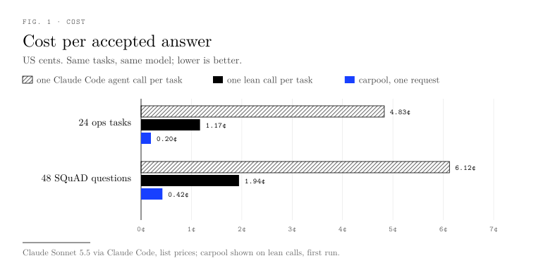
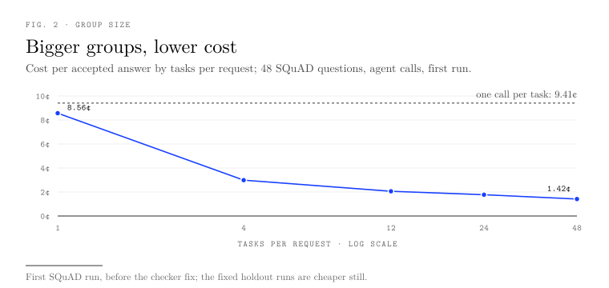
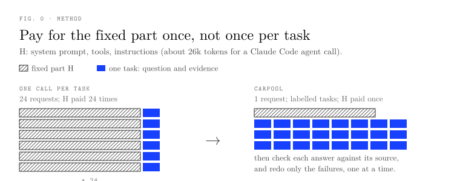

<div align="center">

# carpool

**Why make 24 trips when one carpool do trick.**

Many independent LLM tasks, one verified request.

[](https://github.com/nmayp/carpool/actions/workflows/ci.yml)


</div>

If your script, pipeline or agent makes a separate model call for every item, each call pays for its fixed
setup again: system prompt, tool schemas, instructions. carpool puts independent tasks in one request, checks
every answer against the source it cites, and redoes only the ones that fail. In our tests on Claude, that cut
the cost per accepted answer by about 80% against one lean call per task, and by 93–96% against one Claude Code
agent call per task, with no regressions.[^1]

## 1. Quick start

In Claude Code:

```bash
claude plugin marketplace add nmayp/carpool
```

```bash
claude plugin install carpool@carpool
```

Or try the library offline, no API key needed:

```bash
pip install carpool-agents
```

```bash
carpool bench
```

`carpool bench` uses a mock model with a fixed cost per call, so it shows how carpool works rather than what it
saves. For real numbers run `carpool bench --backend claude-lean` (or `claude-code`, `codex`, `ollama:<model>`, …).

## 2. Results

| set | baseline | one call per task | carpool, first run | cost per accepted answer | regressions |
|---|---|---|---|---|---|
| 24 ops tasks | lean call | 24 calls · 24/24 · $0.281 | 1 call · 24/24 · $0.047 | −83% | 0 |
| 48 SQuAD questions | lean call | 48 calls · 42/48 · $0.817 | 3 calls · 46/48 · $0.195 | −78% | 0 |
| 24 ops tasks | agent call | 24 calls · 24/24 · $1.159 | 1 call · 24/24 · $0.065 | −94% | 0 |
| 48 SQuAD questions | agent call | 48 calls · 40/48 · $2.449 | 2 calls · 44/48 · $0.178 | −93% | 0 |

A *lean call* is Claude through Claude Code with no tools and a one-line system prompt (about 1,100 tokens of
fixed setup); an *agent call* is a full Claude Code session (about 26,000). Repeat runs came out cheaper still
because the provider cached the grouped prompt, so the table quotes first runs.





Every raw JSON file, the ablation, the group-size sweep and the agent experiments are in
[docs/RESULTS.md](docs/RESULTS.md).

What we measured:
- The saving comes from sharing the request. Shortening evidence with one call per task saved 2.5% on the ops
  tasks and cost 5.7% more on SQuAD.
- The bigger each call's fixed setup is compared with one task's own text, the more carpool saves. On a small
  local model with almost no fixed setup, savings were 8–51% and grouping cost some quality.
- A well-behaved interactive agent (Claude Code triaging 20 tickets) showed no measurable change, because it
  already reads everything in one go. When agents did spawn one subagent per file, it cost 4–6× more.

## 3. How it works



The four rules:

1. Run exact work as code. Lookups, counts and filters don't need a model: in the original study, 1,000 of 1,000 order lookups were correct with no model calls.
2. Put independent reasoning tasks in one request. Every task and source gets a stable ID, and the model returns one JSON answer and source ID per task.
3. Send compact evidence only when it's clearly safe: when the best source leads the runner-up by at least 40% (BM25) and isn't a draft. Otherwise send the full evidence straight away.
4. Check every answer and retry only the failures. An answer that is missing, duplicated, cites another task's source or a draft, doesn't appear in its source, sits in an unrelated passage, is an ambiguous number or a name cut short ("London" for "London Exhibition") gets its own full-evidence call.

### The cost model

Every call costs `H + E_i`: shared harness context `H` plus that task's evidence `E_i`.
With `b` separate calls you pay `b·H`. Carpooled, you pay `H` once:

```
C_group = H + Σ E_i + J_b + V_b + Σ_{i∈F} C_retry,i
```

`J_b` is the cost of grouping and formatting, `V_b` the checks, and `F` the
retried tasks. Compression on its own barely helped: when every task still
needed its own call, preflight-only compression saved 0.2%. The tokens are
saved by sharing the request.

## 4. Other ways to use it

### MCP server (Claude Code, Cursor, Windsurf, Cline, Codex, Gemini CLI, Claude Desktop)

```bash
pip install carpool-agents
```

```bash
claude mcp add carpool -- carpool-mcp
```

It adds four tools: `carpool_prompt`, `carpool_verify`, `carpool_run` and `carpool_lookup`, which does exact lookups with no model call. [integrations/MCP.md](integrations/MCP.md) has the config for each client.

### Compile logged calls into code

If a call keeps seeing the same kind of input, a model can write a plain function that handles most of it. Give
`carpool compile` your logged calls, one JSON object per line with an `input` and an `output`:

```bash
carpool compile calls.jsonl --task "map one log line to its event id" --out compiled/solve.py
```

The function may abstain. It is saved only if, on logged calls it didn't learn from, its answers agree with the
logged ones (at least 95%, with a 95% lower bound of at least 85%). In code, `Cascade(fast, slow)` tries the
function first and sends everything it abstains on to the model.

| input | code answers | code + model vs model alone | cost to build | break-even |
|---|---|---|---|---|
| log lines to event ids | 100% | 100% vs 100% | $0.13 | 18 calls |
| banking messages to 77 intents | 5% | 78% vs 78% (refused by the gate) | $0.60 | not worth it |
| questions over passages | 17%, half wrong | 88% vs 96% (would have been refused) | $0.79 | none |

It works on regular text and doesn't on anything that needs meaning. One run, small test sets;
[details and caveats](docs/RESULTS.md#12-compiling-logged-calls-into-code-carpool-compile). The generated file runs
as you, so read it before you deploy it.

**With carpool.** Tasks the compiled file answers skip the model; carpool groups the rest. The loop:

```bash
carpool run tasks.jsonl --backend claude-code > answers.jsonl
```

```bash
carpool compile tasks.jsonl --answers answers.jsonl --task "answer a question from its evidence" --out compiled/solve.py
```

```bash
carpool run new-tasks.jsonl --backend claude-code --compiled compiled/solve.py
```

`carpool bench --compiled compiled/solve.py` adds a third row to the comparison. Where the code answered two thirds
of the tasks, total tokens fell 52% against carpool alone; where it answered 22%, there was no measurable saving
([§13](docs/RESULTS.md#13-compiled-code-in-front-of-carpool)). The first compile on that data was refused by the
gate, over a format mismatch in the log, and the write-up says what was changed afterwards.

### Any other agent (Codex, Cursor, Gemini CLI, Windsurf, Aider…)

Paste the five rules in [`integrations/AGENTS.md`](integrations/AGENTS.md) into your `AGENTS.md`, `.cursorrules`, `GEMINI.md` or system prompt.

### Python library / CLI (zero dependencies)

```bash
pip install carpool-agents
```

These backends report the provider's real usage: `claude-code`, `codex`, `gemini-cli`, `anthropic`,
`openai:<model>` (any OpenAI-compatible endpoint: OpenAI, OpenRouter, Groq, vLLM, LM Studio via `OPENAI_BASE_URL`),
`gemini:<model>`, `ollama:<model>`, plus `cmd:"<any cli>"` (estimated).

### With a ChatGPT or Claude subscription, no API

```bash
carpool prompt my_tasks.jsonl | pbcopy
```

Paste into ChatGPT, Claude.ai or Gemini, then save the reply:

```bash
carpool parse my_tasks.jsonl reply.txt
```

It prints the accepted answers and lists which tasks need a retry, and why.

### As a library

```python
from carpool import Task, Source, run_carpool, AnthropicBackend

tasks = [
    Task("T01", "Which team maintains the fire pump at Mirefield?", [
        Source("T01-a", "The fire pump at Mirefield is maintained by the Halvard Controls Group."),
        Source("T01-b", "The Mirefield canteen closes at 15:00 on Fridays."),
    ]),
    # ... more independent tasks
]

res = run_carpool(tasks, AnthropicBackend())   # or CommandBackend("codex exec -")
for a in res.answers.values():
    print(a.task_id, a.answer, a.source_id, a.route, a.fallback_reason)
print(res.ledger.n_calls, res.ledger.total_tokens, res.ledger.uncached_tokens)
```

Exact operations with a contract check:

```python
from carpool import Index
orders = Index(rows, key="order_id", required=("status",))  # raises if a key repeats or a status is missing
orders.get("W123", "status"); orders.count(status="pending")
```

Tasks file format (`.jsonl`, one task per line; `answers` is optional and only used for scoring):

```json
{"id": "T01", "question": "...", "sources": [{"id": "T01-a", "text": "...", "trusted": true}], "answers": ["..."]}
```

## 5. FAQ

**Isn't this the same as a batch API?** No. Batch APIs (like Anthropic's Message Batches) run many separate
requests later at a discount; each request still pays its full fixed part. carpool cuts the number of requests.
The two stack: `--backend anthropic-batch` sends carpool's grouped requests through the Batches API.

**Doesn't putting many tasks in one prompt hurt quality?** It can, so carpool checks every answer and redoes
failures one by one. On Claude Code we saw 0 regressions on both task sets, and more answers were exactly right
(44–45/48 vs 40/48). On a 1.5B local model, groups of 8 caused 4 regressions against 7 improvements. Measure
on your own tasks: `bench/real.py` reports regressions for you.

**Will it make my everyday Claude Code sessions cheaper?** Probably not by much. Claude Code already reads many
items in one go. The big savings are in code that calls a model once per item. When agents did spawn one
subagent per file in our tests, it cost 4–6 times more for the same result
([details](docs/RESULTS.md#8-does-the-fan-out-hook-change-what-an-agent-does)).

**Doesn't prompt caching already solve this?** Partly. Caching makes the repeated fixed part cheaper but not
free, and it doesn't help output or uncached tokens. In our runs, uncached input plus output also fell by about 80–96%.

**How many tasks per request?** On Claude Code, cost kept falling up to 48. The best size
works out as b* = √(H / (φ(H+E))), where φ is how much each extra task raises the redo rate; `carpool run --adaptive` learns it from the retries it sees. Small local models need
small groups.

**Do I need an API key?** No. `carpool prompt` and `carpool parse` work with a chat subscription, the MCP tools
`carpool_prompt` and `carpool_verify` use the agent you're already talking to, and `--backend claude-code` uses
your Claude Code login.

**How is this different from caveman?** caveman makes the model write fewer words; carpool makes you pay for
fewer requests. They work on different costs, so you can use both.

## 6. Caveats

- All Claude numbers are from Claude Sonnet 5.5 through Claude Code, on short extractive answers, 24 and 48 tasks per set. The fair comparison is against one lean call per task (about 80%); against one full agent call per task it's 93–96%. On a small local model (Ollama, Qwen2.5-1.5B) the savings were small, because a raw API call has almost no fixed part to share, and grouping in 8s cost 4 regressions on SQuAD against 7 improvements ([results](docs/RESULTS.md#7-a-small-local-model-ollama-qwen25-15b-on-4-cpu-cores)). Codex, Gemini and OpenAI-compatible backends exist but haven't been benchmarked.
- Prices are list prices from the CLI, not an invoice. Prompt-cache state changes the cost of a run (repeats are listed separately).
- Zero regressions in 48 tasks bounds the true regression rate at about 6% with 95% confidence, not 0%.
- The verifier fix was designed after inspecting the first SQuAD run, then evaluated on a fresh, disjoint holdout. Both runs are reported.
- Groups can fail together. Stable IDs, per-task source checks and individual fallback limit the damage but don't rule it out.
- The original idea and first results came from the working paper [*Lowering the Cost of Agent Work at a Fixed Quality Target*](docs/PAPER.md) (Codex CLI: −94.6% total tokens, 24/24). Our Claude Code numbers independently reproduce the same pattern.

## 7. Roadmap / help wanted

- [x] Real results on Claude Code ([docs/RESULTS.md](docs/RESULTS.md))
- [x] Results on a local Ollama model ([docs/RESULTS.md](docs/RESULTS.md#7-a-small-local-model-ollama-qwen25-15b-on-4-cpu-cores))
- [ ] Results on Codex, Gemini CLI and larger local models (`python bench/real.py --backend codex`; send a PR with the JSON)
- [x] Message Batches backend: `--backend anthropic-batch` for another 50% off non-urgent work
- [x] `carpool stats results/<file>.json` summarises a saved benchmark
- [x] MCP server ([integrations/MCP.md](integrations/MCP.md))
- [x] Batching vs compact-evidence ablation (batching drives the savings)
- [x] `carpool compile`: logged model calls into a plain function, behind a gate ([results](docs/RESULTS.md#12-compiling-logged-calls-into-code-carpool-compile))
- [x] Learning group sizes automatically from retry rates (`carpool run --adaptive`, [results](docs/RESULTS.md#5-adaptive-group-size-learned-during-the-run))
- [x] A hook that notices "N subagents for N tiny questions" and suggests a carpool (ships with the plugin)
- [x] Measure whether the hook's note changes agent behaviour: it doesn't, because agents launch subagents in one batch before the note arrives ([results](docs/RESULTS.md#8-does-the-fan-out-hook-change-what-an-agent-does))
- [x] A hook that acts before the first subagent launch, without overruling users who ask for subagents ([results](docs/RESULTS.md#9-a-hook-that-acts-before-the-first-launch))
- [ ] Find out why plugins with any hook on the subagent tool fanned out in 1 of 14 runs (against 6 of 8 without), even a hook that does nothing ([results](docs/RESULTS.md#10-is-it-just-having-a-hook-registered))

## 8. Contributing

Benchmark results from other clients and models help most; failures are as welcome as successes. See
[CONTRIBUTING.md](CONTRIBUTING.md). Please follow the [code of conduct](CODE_OF_CONDUCT.md), and report
security problems privately ([SECURITY.md](SECURITY.md)).

To cite carpool, use the "Cite this repository" button (from [CITATION.cff](CITATION.cff)).

## 9. Related work

carpool builds on earlier work; the core idea of several tasks in one request is not new.

- **Batch prompting.** [Cheng et al., 2023](https://arxiv.org/abs/2301.08721) ([code](https://github.com/hkunlp/batch-prompting))
  put several samples in one prompt and reported cost falling almost in proportion to the batch size, with accuracy
  dropping on larger batches. carpool uses the same idea and adds what a production pipeline needs
  around it: an ID for every task and source, a check of every answer against the source it cites, a redo of
  only the failed tasks, and a group size learned from the redo rate.
- **Many questions in one prompt.** Studies such as
  [*Evaluating LLMs with Multiple Problems at once*](https://arxiv.org/abs/2406.10786) and
  [*How Accurate Are LLMs at Multi-Question Answering*](https://arxiv.org/abs/2509.21732) measure how accuracy
  changes as questions are added. That risk is why carpool checks every answer and reports regressions instead
  of assuming grouping is free.
- **Provider batch APIs and parallel-call libraries.** Anthropic's Message Batches and similar APIs, and
  libraries such as [LiteLLM](https://docs.litellm.ai/docs/completion/batching), still send one request per
  task: they make each request cheaper or faster, not fewer. carpool can send its grouped requests through
  the Batches API (`--backend anthropic-batch`).
- **Prompt caching** makes the repeated fixed part of each request cheaper but not free. Our Claude Code costs
  are the CLI's own figures, cache discounts included (see the FAQ).
- **Prompt compression,** such as [LLMLingua](https://arxiv.org/abs/2310.05736), shortens the input of each
  request. carpool's compact-evidence step is a simple version of that with a checked fallback; on its own it
  changed cost by −2.5% to +5.7% in our ablation ([results](docs/RESULTS.md#2-squad-48-first-run-ablation-and-group-size-sweep)).
- **Answers with citations.** Checking that an answer is supported by the passage it cites follows work on
  attributed answers such as [ALCE](https://arxiv.org/abs/2305.14627). carpool's checker is deliberately
  simple and rule-based (exact text, numbers with units, names), so it costs no extra model calls.

## 10. Credits

Inspired by [caveman](https://github.com/JuliusBrussee/caveman) (fewer output tokens), Pomerado (callable
operations), The Token Company (input compression) and Confident AI (agent evals). caveman reduces what the
model writes; carpool reduces how many requests you pay for.

MIT licensed.

[^1]: Claude Sonnet 5.5 via Claude Code at list prices; 24 fictional operations tasks and 48 public SQuAD questions, first runs. Details and every raw result: [docs/RESULTS.md](docs/RESULTS.md) §1–3 and §11.
